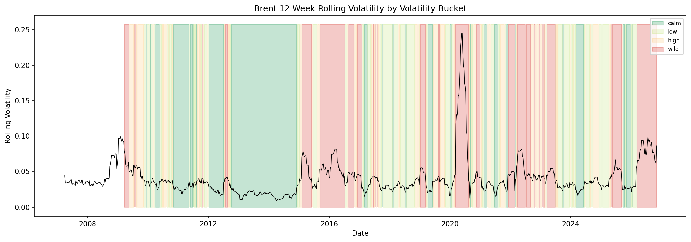

# When Does Historical VaR Fail? A Weekly Backtest on Energy Markets

Rolling historical-simulation Value-at-Risk (VaR) for WTI crude, Brent crude and Henry Hub natural gas, backtested over Mar 2007 to Oct 2026. The project tests whether the overall breach rate is right, and whether breaches **cluster** in high-volatility periods.

> **Status:** v1.0 in progress. Numbers marked *preliminary* will change before release.

---

## Question

A 5% VaR should be breached about 1 week in 20. Historical VaR estimates it from a trailing window of past returns, which assumes the recent past looks like next week. Energy markets move between calm and turbulent stretches, so:

1. Does rolling historical VaR get the overall 5% breach rate right?
2. Are breaches spread evenly over time, or do they bunch up when volatility is high?

---

## Key results

> TODO (Ben): replace with final numbers and a 3-sentence summary in your own words once the backtest table and bucket tables are done.

**Breach rates of rolling 5% VaR** *(preliminary)*

| Series | 52-week window | 78-week window | 104-week window |
| --- | --- | --- | --- |
| WTI | 7.4% | 6.8% | 6.2% |
| Brent | 7.3% | 7.3% | 6.7% |
| Henry Hub | 6.8% | 6.6% | 6.2% |

- Every series and window breaches above the 5% target.
- Kupiec rejects a 5% breach rate at the 52 and 78-week windows for all three series.
- Longer windows breach less.

**Breach clustering (Christoffersen test):** TODO

**Breach rate by volatility bucket:** TODO (table: calm / low / high / wild, each series on its own volatility)



> TODO (Ben): save the figure to `figures/` with `plt.savefig("figures/brent_vol_buckets.png", dpi=150, bbox_inches="tight")`.

---

## Data

| Source | Series | Use |
| --- | --- | --- |
| EIA | WTI spot (RWTC), Brent spot (RBRTE), Henry Hub spot (RNGWHHD) | Returns, VaR |
| EIA | US crude inventories (WCESTUS1) | Regression appendix |
| FRED | 10Y-2Y spread (T10Y2Y), VIX (VIXCLS), broad dollar index (DTWEXBGS) | Regression appendix |

Weekly frequency, Friday-aligned, about 1,000 observations.

---

## Method

1. **Returns.** Weekly log returns. ADF and KPSS tests confirm they are stationary.
2. **Return characteristics.** Skewness, excess kurtosis, and Ljung-Box tests on squared returns, to check for fat tails and volatility clustering before testing VaR.
3. **Rolling historical VaR.** The 5th percentile of the previous 52, 78 or 104 weekly returns. Week *t*'s VaR uses only weeks up to *t-1*, so every week is an out-of-sample forecast (walk-forward backtest). No separate train/test split is needed.
4. **Backtests.**
   - *Kupiec proportion-of-failures test:* is the breach rate consistent with 5%?
   - *Christoffersen independence test:* is a breach more likely right after another breach?
5. **Volatility buckets.** Each series gets its own labels. A week is calm, low, high or wild depending on which quartile last week's 12-week volatility falls in, compared with that series' history up to that point (expanding window). Labels only use data available at the time, so the first two years (most of 2008) have no label. Breach rates are compared across buckets.
6. **PELT changepoints** (descriptive only). Segments the sample into broad volatility eras for context.

---

## A note on April 2020

WTI's raw statistics are dominated by two weeks. The week ending 2020-04-24 had a log return of -1.80, followed by a +1.55 rebound. COVID lockdowns collapsed demand, storage at Cushing, Oklahoma filled up, and the expiring futures contract went negative. Brent, a seaborne benchmark, had no equivalent storage squeeze.

| WTI | With April 2020 | Without those 2 weeks | Brent (for comparison) |
| --- | --- | --- | --- |
| Excess kurtosis | 255.4 | 9.8 | 10.4 |
| Annualized vol | 64% | 35% | 36% |

These weeks are **kept** in the VaR backtest because the loss was real. They also wreck PELT on WTI's volatility, which is part of why PELT is only used as a rough description.

---

## Limitations

- **PELT uses the full sample.** The PELT eras describe where breaches happened, they don't forecast. The volatility buckets avoid this by using an expanding window.
- **Uneven buckets.** Expanding-window quartiles don't split the sample 25/25/25/25, and the first two years (including most of 2008) have no bucket.
- **Weekly data.** Weekly data gives about 50 to 70 breaches per series, so the backtests have limited power.
- **Historical simulation only.** No volatility model (EWMA, GARCH) is compared yet.

---

## Future work

- **GARCH or EWMA VaR** as a benchmark in the same backtest table, to test whether a model that adapts to volatility removes the clustering.
- **Regime-aware VaR forecast** using a hidden Markov model with filtered (real-time) state probabilities, evaluated on a held-out period.
- Daily data for more breaches and more test power.

---

## Appendix: macro drivers

OLS regressions of weekly returns on inventory changes, VIX, the yield curve and the dollar index (HAC standard errors) explain little of the variation (R² of 0.02 to 0.09). Rolling regressions show the inventory coefficient is unstable over time, which motivated looking at volatility regimes.

> TODO (Ben): one sentence on what you take from this, in your own words.

---

## Repository layout

```
data/
  fomc_meetings.csv, opec_meetings.csv   Event calendars
notebooks/
  demo.ipynb                 Full analysis (logic lives in src/)
scripts/
  build_meeting_dates.py     Scrapes FOMC/OPEC calendars into data/
src/regime_detection/
  ingestion.py               EIA + FRED pulls, merged weekly panel
  features.py                Log returns, diffs, lags, rolling volatility
  stationarity.py            ADF / KPSS classification and transforms
  regression.py              OLS + HAC, rolling OLS, residual diagnostics
  changepoints.py            PELT with CROPS penalty search, volatility buckets
  risk.py                    Rolling VaR, VaR/CVaR tables, breach rates
  backtest.py                Kupiec and Christoffersen tests, backtest table, breach rate by group
  hmm.py                     Gaussian HMM (experimental, not used in v1.0)
```

---

## Setup

```bash
uv venv && uv pip install -e ".[dev]"
```

Create a `.env` file at the repo root:

```
EIA_API_KEY=...
FRED_API_KEY=...
```

Then open `notebooks/demo.ipynb` and run all cells.